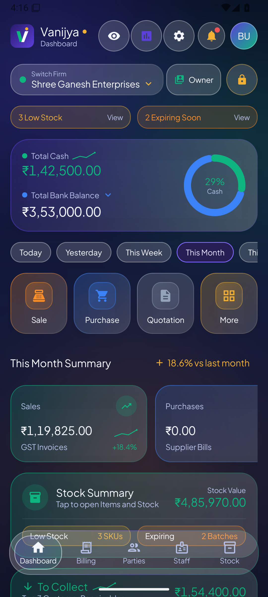
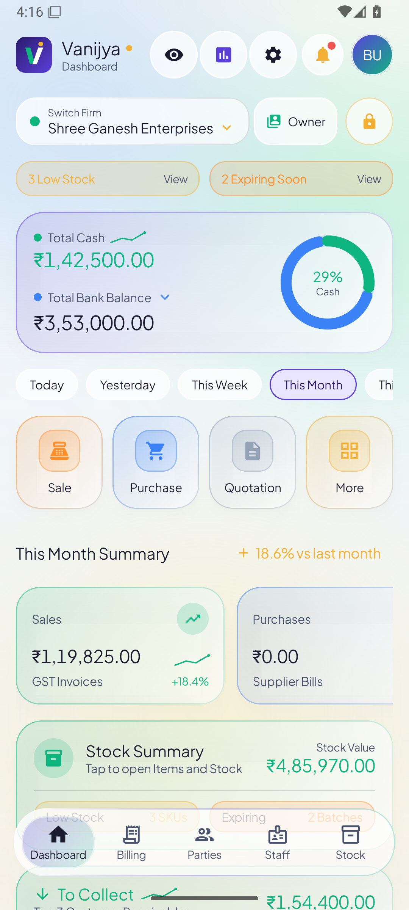
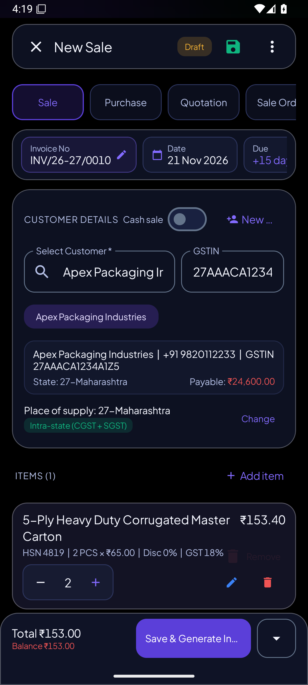
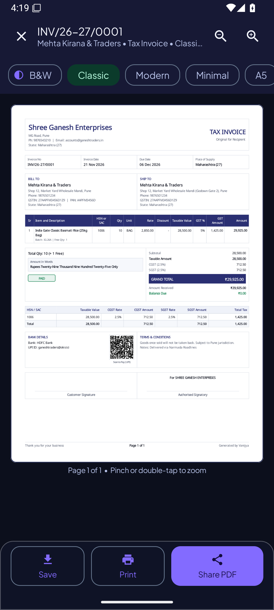

<div align="center">

# Vanijya

### Your business, in your pocket. Fully offline.

**वाणिज्य** (*Vanijya*) means *commerce*. A premium, offline-first business and GST billing app for Android.


</div>

---

## ✨ Why Vanijya?

Most billing apps keep your business data on someone else's server. **Vanijya keeps everything on your phone.** There is no cloud, no account, no tracking and no internet permission. Your sales, stock, staff and accounts stay with you, protected by an encrypted database and your fingerprint.

When you change phones, you carry one backup file (`.vbk`) and restore everything in a minute.

| | |
|---|---|
| 🔒 **Private by design** | No internet permission, no analytics, no ads, no cloud login |
| 🧾 **GST ready** | CGST / SGST / IGST, HSN summaries, GST report exports |
| 📦 **All-in-one** | Billing, stock, parties, payroll, cash book and reports in one app |
| 💎 **Premium feel** | Glassmorphism UI with Light, Dark and AMOLED themes |
| 💾 **One-file backup** | Move your whole business to a new phone with a single `.vbk` file |

---

## 📱 Screenshots

| Dashboard (Dark) | Dashboard (Light) | Create Invoice | Invoice PDF |
|:---:|:---:|:---:|:---:|
|  |  |  |  |

---

## 🚀 Features

### 🧾 Sales and Billing
- Tax Invoice, Bill of Supply, Retail Sale, Quotation, Sale Order, Delivery Challan, Proforma, Credit and Debit Notes
- Itemised bills with quantity, rate, discount, GST rate and live totals
- Automatic CGST + SGST or IGST by place of supply
- One-tap conversion: Quotation → Order → Invoice → Return
- Partial payments, multiple payment modes, cheque register
- Professional PDF invoices in multiple templates, with UPI QR, bank details and signature

### 📦 Stock and Inventory
- Items with HSN/SAC, units and conversions, barcode scanning, images
- Batch, serial and expiry tracking, multiple godowns, low-stock alerts
- Stock ledger, adjustments, transfers, valuation (weighted average and FIFO)

### 👥 Parties
- Customers and suppliers with GSTIN validation, credit limits and outstanding balances
- Party ledger and PDF statement, ageing analysis, WhatsApp / SMS reminder templates

### 💰 Cash Book, Bank and Expenses
- Automatic day book, bank accounts and transfers, reconciliation
- Expense categories, receipts, budgets and recurring expenses

### 🧑‍💼 Staff, Attendance and Payroll
- Employee profiles, daily attendance, leave and holiday calendar
- Salary calculation from attendance, overtime, advances and loan recovery
- Branded payslip PDFs, salary register, PF / ESI / PT summaries

### 📊 Reports and Compliance
- Profit and Loss, Balance Sheet, Trial Balance, Cash Flow
- GSTR-1, GSTR-3B summaries and GST portal JSON exports
- ITR support pack (the "CA Pack"): summaries, depreciation, advance tax tracker and more, bundled as PDF, Excel and CSV
- Every report exports as a clean, print-ready PDF

### 🔐 Security and Backup
- Fingerprint / face unlock with PIN fallback and auto-lock
- Encrypted on-device database
- One-file `.vbk` backup with optional password, plus restore on a fresh install
- Local roles: Owner, Manager, Salesperson, Accountant, Viewer

---

## 🧱 Tech Stack

| Layer | Technology |
|---|---|
| Language | Kotlin |
| UI | Jetpack Compose, Material 3, glassmorphism design system |
| Architecture | Clean Architecture, MVVM, package-by-feature |
| Dependency injection | Hilt |
| Database | Room (SQLite) with SQLCipher encryption |
| Async | Coroutines and Flow, Paging 3 |
| Biometrics | AndroidX BiometricPrompt |
| PDF | Custom offline PDF layout engine |
| Background work | WorkManager (local reminders, scheduled backup) |
| Barcode | CameraX with on-device ML Kit, ZXing |

---

## 🗂️ Project Structure

```text
vanijya-android/
├── app/                  # Application entry point and navigation
├── core/                 # Shared UI, database, PDF, backup, security
└── feature/              # parties, items, sales, purchases, cash,
                          # staff, payroll, gst, reports, settings
```

---

## 🛠️ Getting Started

**Requirements**
- Android Studio (latest stable)
- JDK 17
- Android SDK with API 26 or higher

**Run the app**
```bash
git clone https://github.com/shawavishek103-rgb/vanijya-android.git
cd vanijya-android
./gradlew assembleDebug
```
Then open the project in Android Studio and run it on an emulator or a real phone. Fingerprint, camera barcode scanning and Bluetooth printing need a real device to test fully.

**Run the tests**
```bash
./gradlew test
```

---

## 💾 How Backup and Restore Works

1. Go to **Settings → Backup and Restore → Backup now**.
2. Choose where to save the `.vbk` file and, if you like, set a password.
3. On the new phone, install Vanijya and tap **Restore from backup** on the first screen.
4. Pick the `.vbk` file. Everything returns: parties, items, invoices, payments, staff, settings, logo and signature.

> ⚠️ Keep a copy of your backup somewhere other than your phone. If you set a password, it cannot be recovered.

---

## 🔒 Privacy

- The app does not request the `INTERNET` permission.
- No analytics, ads, crash-reporting SDKs or cloud services are used.
- All data lives in an encrypted database on your device.
- You decide where backups are saved.

---

## 🗺️ Roadmap

- [x] Foundation: theme, navigation, security, onboarding
- [x] Parties and Items
- [x] Itemised GST billing
- [x] Professional PDF invoices and templates
- [x] Purchases and stock valuation
- [ ] Cash book, bank and expenses
- [ ] Staff, attendance and payroll
- [ ] GST reports, business reports and ITR pack
- [ ] Backup and restore
- [ ] Polish: widgets, shortcuts, Hindi and other languages

---

## ⚠️ Disclaimer

Vanijya helps prepare GST and income-tax data, but it is not tax advice and does not file returns. Tax rates, thresholds and statutory rules change, so please have a Chartered Accountant verify returns and reports before filing.

---

## 🤝 Contributing

This project is in active development. Ideas and bug reports are welcome through GitHub Issues.

## 📄 License
All rights reserved

---

<div align="center">

**Built with ❤️ for small businesses.**

*Vanijya: your business, in your pocket.*

</div>
